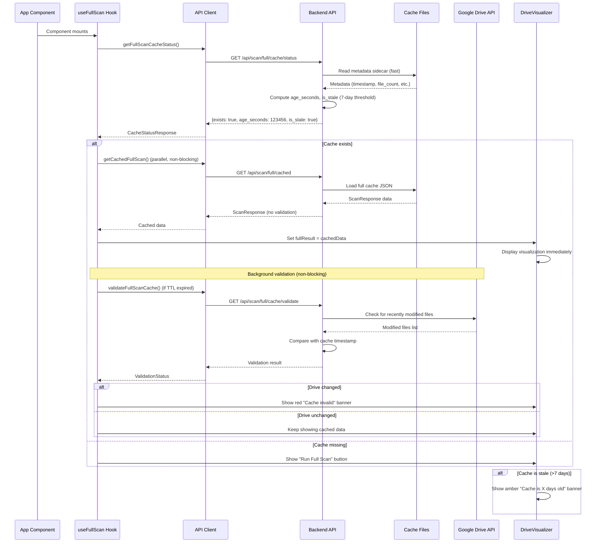
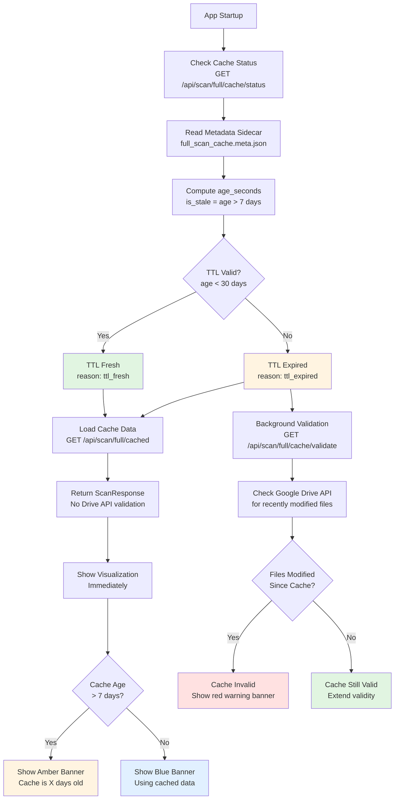
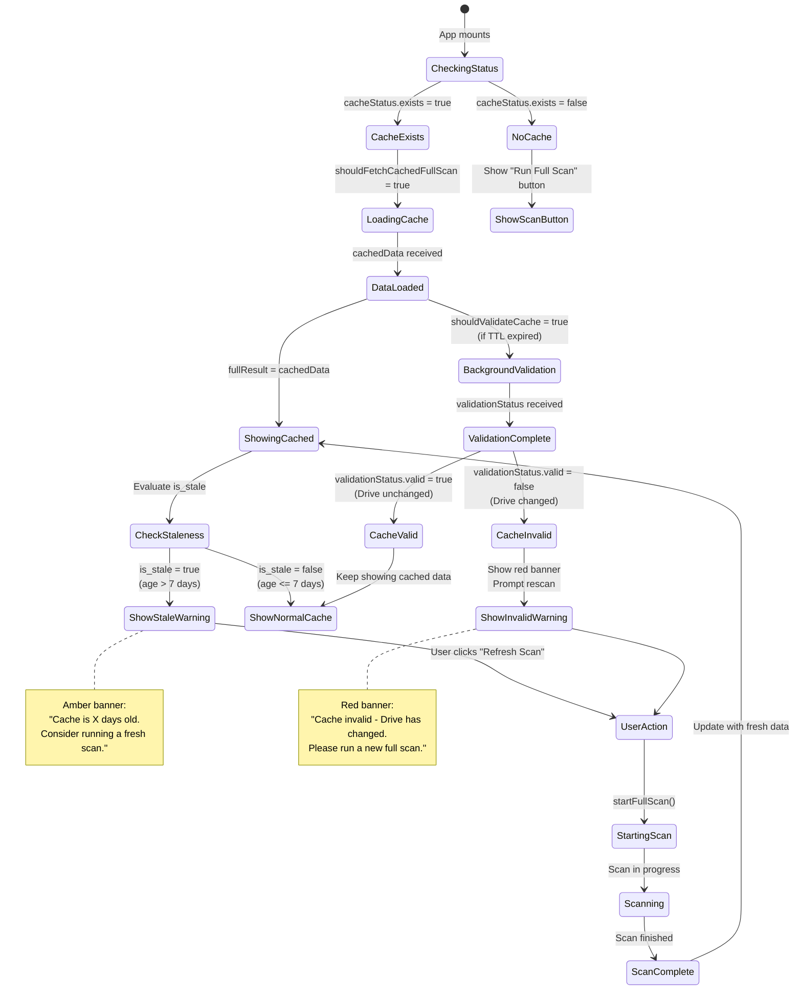
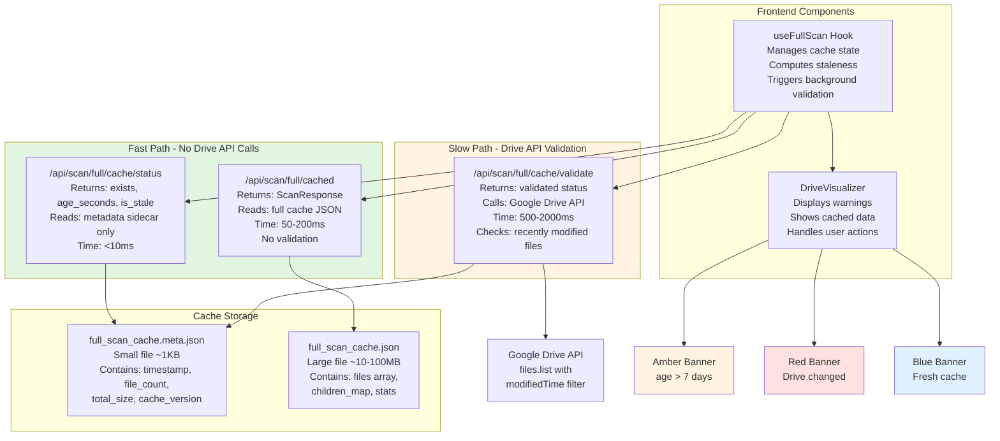
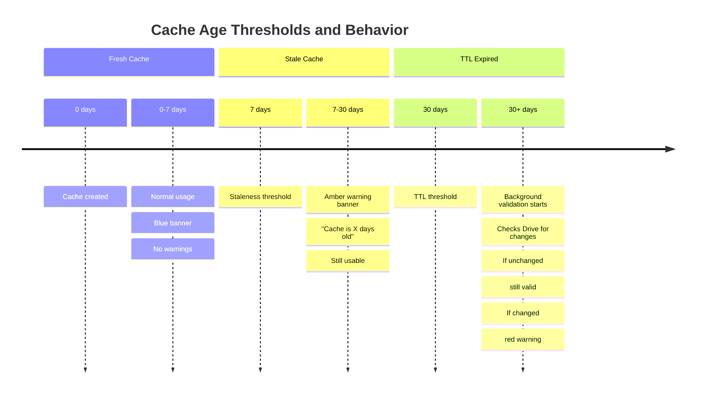

# Cache Dataflow Documentation

This document describes the dataflow and architecture of the full scan caching system, including how cached data is loaded, validated, and displayed to users.

## Overview

The caching system is designed to provide instant app startup by loading cached full scan data immediately, while handling staleness warnings and validation in the background. The system uses a two-stage approach:

1. **Fast Path**: Load cached data immediately without Drive API validation
2. **Background Validation**: Validate cache against Google Drive API when needed

## 1. App Startup Flow - Cache Loading Sequence

## 2. Cache Validation Strategy

## 3. Frontend Hook State Management

## 4. Backend Endpoint Responsibilities

## 5. Cache Age Thresholds

## Key Design Decisions

### Instant Loading
- Cached data loads immediately without waiting for Drive API validation
- This ensures fast app startup even with large caches
- Validation happens in the background and doesn't block the UI

### Staleness Thresholds
- **7 days**: Staleness warning threshold - shows amber banner
- **30 days**: TTL threshold - triggers background validation
- Cache can remain valid indefinitely if Drive hasn't changed

### Two-Stage Validation
1. **Fast TTL check**: Based on cache age only (no API calls)
2. **Drive API validation**: Checks for actual file changes (slower, runs in background)

### Warning Banners
- **Blue**: Fresh cache (< 7 days old)
- **Amber**: Stale cache (> 7 days old) - informational warning
- **Red**: Invalid cache (Drive has changed) - requires rescan

## API Endpoints

### GET /api/scan/full/cache/status
- **Purpose**: Fast cache existence and staleness check
- **Reads**: Metadata sidecar file only (~1KB)
- **Returns**: `exists`, `age_seconds`, `is_stale`, `valid` (TTL-based)
- **Performance**: <10ms

### GET /api/scan/full/cached
- **Purpose**: Load cached full scan data
- **Reads**: Full cache JSON file (~10-100MB)
- **Returns**: `ScanResponse` with files, children_map, stats
- **Validation**: None (loads unconditionally if file exists)
- **Performance**: 50-200ms depending on file size

### GET /api/scan/full/cache/validate
- **Purpose**: Validate cache against Google Drive API
- **Reads**: Metadata sidecar + Drive API call
- **Returns**: Validated status with Drive API check results
- **Performance**: 500-2000ms (includes Drive API latency)
- **Usage**: Background validation when TTL expired

## Frontend Hook: useFullScan

The `useFullScan` hook manages the cache lifecycle:

1. **On mount**: Checks cache status immediately
2. **If cache exists**: Loads cached data in parallel
3. **If TTL expired**: Triggers background validation
4. **Staleness detection**: Uses `is_stale` flag from backend
5. **Warning management**: Exposes `cacheWarning` and `isCacheStale` for UI

## Component: DriveVisualizer

The main visualization component handles:

1. **Banner display**: Shows appropriate warning based on cache state
2. **User actions**: Handles "Refresh Scan" button clicks
3. **Data display**: Shows visualization immediately when cached data loads
4. **State management**: Coordinates between quick scan and full scan data

## Performance Characteristics

| Operation | Time | Drive API Calls |
|-----------|------|-----------------|
| Cache status check | <10ms | 0 |
| Load cached data | 50-200ms | 0 |
| Background validation | 500-2000ms | 1 |
| Full scan (fresh) | 2-5 minutes | Many |

## Related Documentation

- [CACHING_STRATEGY.md](CACHING_STRATEGY.md) - Overall caching approach
- [OPTIMIZED_CACHING.md](OPTIMIZED_CACHING.md) - Performance optimizations
- [CACHING_STATUS.md](CACHING_STATUS.md) - Cache status tracking
